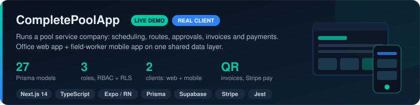
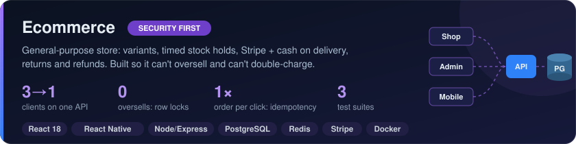
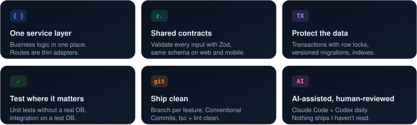
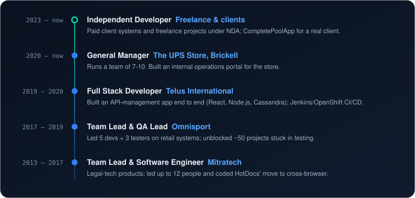

  

  
  
  
  

  Full stack developer with <b>7+ years</b> in software, including team lead and QA lead roles. 
  I build business software real operations run on: scheduling, billing, inventory, payments and role-based access. 
  Moving from <b>Miami</b> to <b>San Salvador</b> · open to <b>remote roles across LATAM</b> and <b>on-site/hybrid in El Salvador</b>.

 

<h2 align="center">Featured Projects</h2>

  
  <a href="https://github.com/sahc1987/CompletePoolApp">Repository</a> · <a href="https://complete-pool-app.vercel.app">Live demo (read-only)</a>

  
  <a href="https://github.com/sahc1987/Ecommerce">Repository</a>

 

<h2 align="center">How I Build</h2>

  

 

<h2 align="center">Experience</h2>

  

<b>Full details</b>

 

| Years | Role | Company | Highlights |
|---|---|---|---|
| 2023 – now | Independent Developer | Freelance & clients | Paid client systems and freelance projects (Upwork, Workana and others, under NDA); CompletePoolApp for Complete Pool Service |
| 2020 – now | General Manager | The UPS Store, Brickell | Runs a team of 7-10; built an internal operations portal for the store |
| 2019 – 2020 | Full Stack Developer | Telus International | Built an API-management app end to end (React, Node.js, Cassandra): API catalog, consumer onboarding and keys, usage monitoring; maintained PHP and Angular apps and Jenkins/OpenShift pipelines |
| 2017 – 2019 | Team Lead & QA Lead | Omnisport | Led **5 developers + 3 testers** on in-house retail systems (POS, inventory, billing, credit); unblocked **~50 projects** stuck in testing by reworking acceptance and building regression suites |
| 2013 – 2017 | Team Lead & Software Engineer | Mitratech | Legal-tech products for law firms and corporate legal teams; led up to **12 people** and coded the HotDocs move from IE-only to cross-browser (Java, JavaScript, .NET) |

 

<h2 align="center">Tech Stack</h2>

    
    
    
    
    
  

  
  
  
  
  
  
  
  
  
  
  

 

<i>"Ship it working, test it before users do, keep learning."</i>

